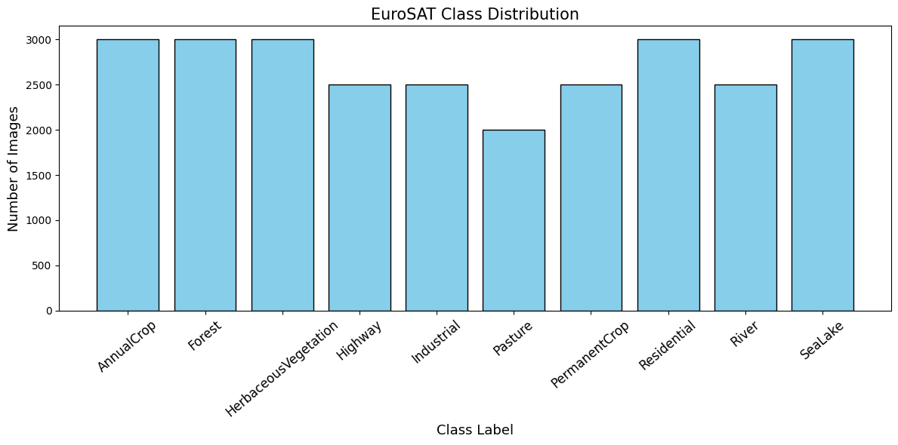

# Remote Sensing Computer Vision

Academic experiments in **land-use / land-cover classification** and **object detection in optical remote sensing imagery**, spanning handcrafted features, neural networks, transfer learning, and decision fusion.

This portfolio demonstrates image preprocessing, feature engineering, annotation conversion, model training, and critical evaluation for Earth Observation applications. The work uses optical imagery; it does not implement SAR processing, geospatial deployment, or operational change detection.

## Explore the projects

- **[EuroSAT — Land Cover Classification](eurosat/README.md):** 27,000 RGB image patches and 10 classes; HOG, Gabor filters, RGB color moments, SVM, KNN, ANN, CNN, MobileNetV2, and exploratory decision fusion. Three notebooks include saved reports and visualizations.
- **[DIOR — Object Detection](dior/README.md):** XML-to-YOLO annotation conversion, an 800-image subset, and YOLOv8n / YOLOv8s fine-tuning with full or partially frozen networks. Includes saved validation results, training histories, and precision–recall curves.



## What the recorded experiments show

EuroSAT's MobileNetV2 reports round to **0.90 accuracy with a frozen backbone** and **0.91 after partial fine-tuning**, on a 5,400-image test directory. DIOR's YOLOv8s run with `freeze=10` records **0.5339 mAP@0.50** and **0.3443 mAP@0.50:0.95** on 120 validation images.

These are historical notebook results, not newly reproduced benchmarks. Evaluation protocols differ across experiments; the project guides document leakage risks, missing split manifests, preprocessing inconsistencies, and mismatched validation populations. Decision fusion did not outperform the CNN on its exploratory sample. Feature-level fusion was not found in the supplied implementation.

## Repository map

```text
eurosat/       Three notebooks, project guide, requirements, figures
dior/         Detection notebook, reconstructed data config, requirements, evidence
docs/         Provenance, preparation changes, source hashes, recorded result excerpts
tools/        Lightweight offline publication validation
```

## Installation and reproduction

1. Clone this repository and create a separate Python environment for each project.
2. Install that project's `requirements.txt` and start Jupyter from its directory.
3. Obtain datasets separately using the links in each project guide and arrange the documented directory layout.
4. Review the execution prerequisites before running cells. Reading the notebooks and figures requires no training or dataset download.

Example (PowerShell, from the repository root):

```powershell
python -m venv .venv-eurosat
.\.venv-eurosat\Scripts\python -m pip install -r eurosat/requirements.txt
Set-Location eurosat
..\.venv-eurosat\Scripts\python -m jupyter lab
```

Dependencies for EuroSAT are an inferred installation baseline, not a recovered environment lock. DIOR pins the Ultralytics and PyTorch versions recorded in its output. Exact historical reproduction is limited by absent data splits and checkpoints. No model was retrained during portfolio preparation.

## Evidence and scope

- [Preparation and reproducibility notes](docs/PROVENANCE.md)
- [Original source hashes and published filename mapping](docs/source_manifest.json)
- [Recorded notebook result excerpts](docs/recorded_results.json)
- [Offline publication validator](tools/validate_portfolio.py)

The original workspace files are preserved outside this publishing copy. Datasets, environment folders, cached arrays, serialized scalers, and model weights are excluded. Dataset and framework rights remain with their respective owners; this repository does not grant a new license to those materials.
