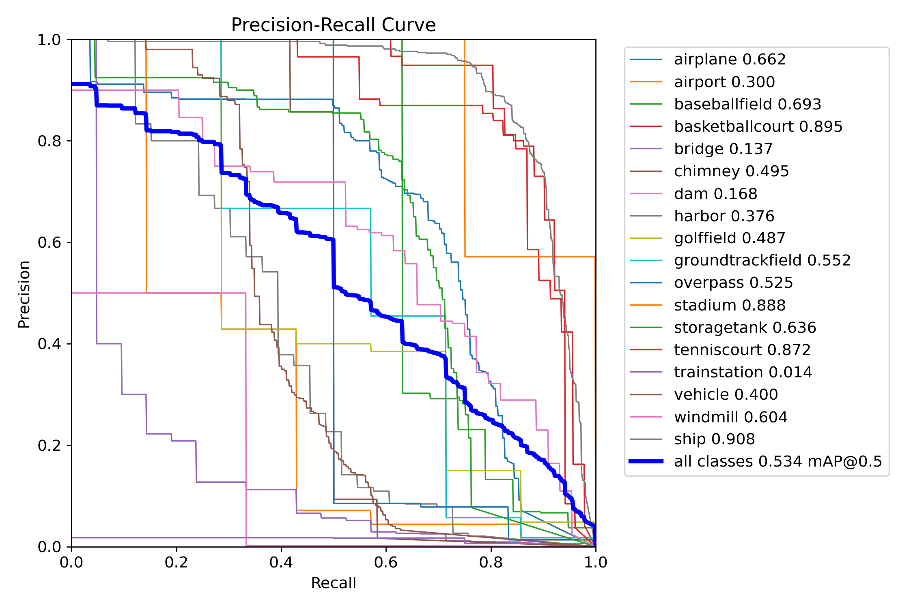
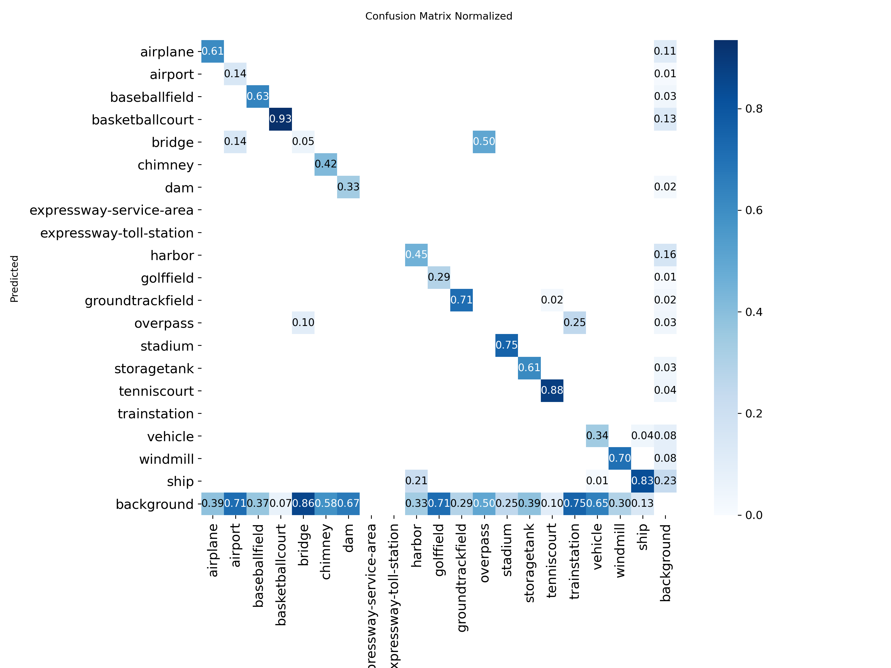

# DIOR — Object Detection in Remote Sensing Imagery

An undergraduate Computer Vision project applying YOLOv8 to optical remote sensing imagery, from annotation preparation to detector fine-tuning and visual evaluation.

[← Back to portfolio](../README.md)

## Dataset and Objective

[DIOR](https://gcheng-nwpu.github.io/) contains optical remote sensing images with horizontal bounding-box annotations across 20 object categories, including airplanes, ships, vehicles, bridges, and storage tanks.

The coursework uses an **800-image subset**, divided into **560 training**, **120 validation**, and **120 test images**. The objective is to gain practical experience preparing detection data and exploring YOLOv8n and YOLOv8s adaptation strategies.

## Implemented Workflow

1. Inspect sample images, XML annotations, and object-class distributions.
2. Convert XML boxes into YOLO labels with normalized center coordinates, width, and height.
3. Select labeled images and prepare a 70/15/15 data split.
4. Fine-tune pretrained YOLOv8 models for **10 epochs**, using **640-pixel image size** and **batch size 4**.
5. Evaluate trained checkpoints using precision, recall, mAP, confusion matrices, and detection visualizations.

**Technologies:** Python, Ultralytics YOLO, PyTorch, NumPy, Pillow, Matplotlib, Seaborn, and Jupyter Notebook.

[Open the detection notebook →](01_yolo_detection.ipynb)

## Models

| Model | Training configuration | Saved run |
|---|---|---|
| YOLOv8n | Full-network fine-tuning from pretrained weights | `train_pretrained` |
| YOLOv8n | Fine-tuning with the first 10 modules frozen (`freeze=10`) | `head_only` |
| YOLOv8s | Fine-tuning with the first 10 modules frozen (`freeze=10`) | `head_only2` |

All three experiments train on DIOR starting from pretrained weights. The `head_only` run names refer to the `freeze=10` configuration; trainable layers extend beyond the final prediction layer.

## Recorded Validation Results

These metrics are from saved outputs of the original coursework experiments and have not been independently reproduced. All rows use 120 validation images; the separate test subset is not used for these reported results.

| Model / configuration | Precision | Recall | mAP@0.50 | mAP@0.50:0.95 |
|---|---:|---:|---:|---:|
| YOLOv8n, full-network fine-tuning | 0.6044 | 0.4169 | 0.4507 | 0.3121 |
| YOLOv8n, `freeze=10` | 0.5198 | 0.3570 | 0.3705 | 0.2312 |
| YOLOv8s, `freeze=10` | 0.6545 | 0.4466 | 0.5339 | 0.3443 |

The full-network run evaluates 1,356 objects, while the frozen-module runs evaluate 1,382, so the rows represent different evaluation populations rather than a controlled ranking. Reports cover 18 classes with instances; class-name casing in annotation conversion can omit the two expressway categories, so the metrics do not establish full 20-class coverage.

mAP@0.50 summarizes average precision at an intersection-over-union threshold of 0.50; mAP@0.50:0.95 averages across thresholds from 0.50 to 0.95. Values above are fractions, not percentages.

## Visualizations

The saved YOLOv8s training run includes a precision–recall curve and a normalized confusion matrix:





Browse the [saved experiment artifacts](evidence/) for training curves, CSV histories, configurations, and additional plots. These figures come from the training runs; the table above records the notebook's later validation calls.

## Running Locally

Create a Python environment, install [requirements.txt](requirements.txt), and launch Jupyter from `dior/`:

```bash
python -m pip install -r requirements.txt
python -m jupyter lab
```

Obtain DIOR from the dataset authors and arrange the source images and annotations:

```text
dior/
  dataset/JPEGImages/*.jpg
  dataset/Annotations/*.xml
  data.yaml
```

Set `path` in [data.yaml](data.yaml) to the absolute path of your `dior/` directory. With data arranged manually, skip the first two archive-extraction cells and choose an existing image filename for the sample display. The conversion and split cells generate `YOLO_Labels/` and `train/`, `val/`, and `test/` directories; start with fresh split folders when preparing a new experiment.

Original split memberships are not included, so a new random subset may produce different results. Training generates checkpoints under `runs/`; the final evaluation cells require those checkpoints locally. Datasets and weights are excluded from Git, while saved outputs and plots remain available for browsing.

**Dataset reference:** Li et al., [*Object Detection in Optical Remote Sensing Images: A Survey and A New Benchmark*](https://arxiv.org/abs/1909.00133).
