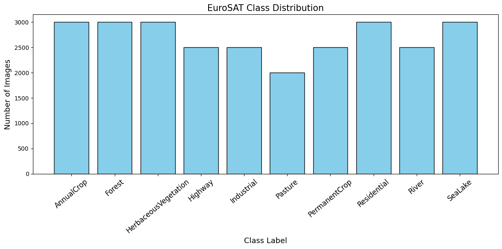
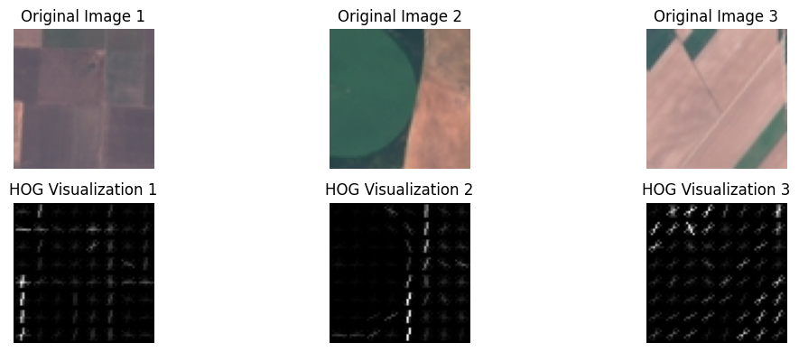
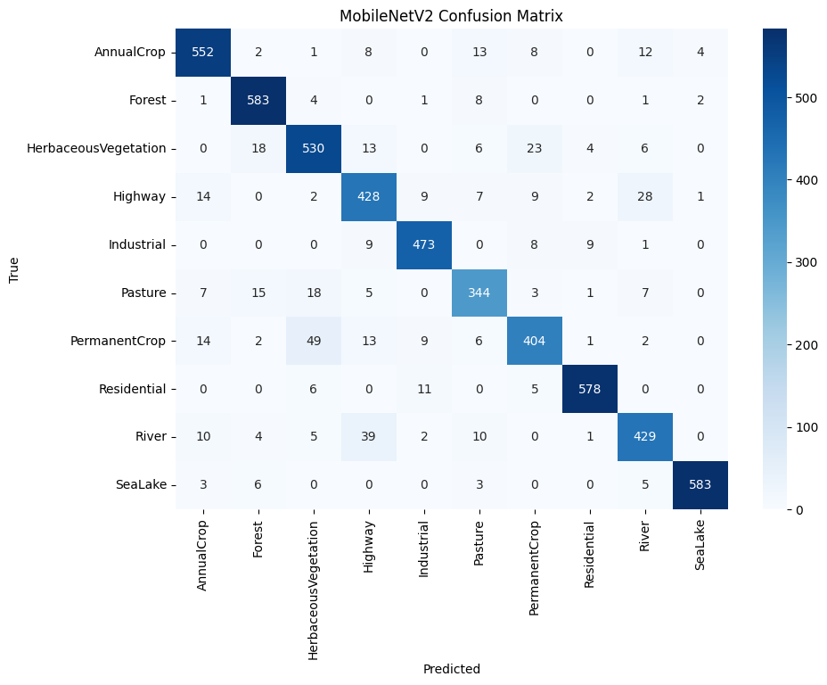

# EuroSAT — Land Use / Land Cover Classification

An undergraduate Computer Vision project exploring how handcrafted features, neural networks, and transfer learning classify satellite image patches into land-use and land-cover categories.

[← Back to portfolio](../README.md)

## Dataset and Objective

The project uses the RGB version of [EuroSAT](https://github.com/phelber/EuroSAT): **27,000 satellite image patches**, each **64 × 64 pixels**, across **10 classes**.

The classes are AnnualCrop, Forest, HerbaceousVegetation, Highway, Industrial, Pasture, PermanentCrop, Residential, River, and SeaLake. The objective is to explore image representations and classification approaches, and examine their predictions through metrics and visualizations.



## Implemented Methods

- **Feature extraction:** grayscale HOG descriptors, Gabor filter response statistics, and RGB color moments (mean, standard deviation, and skewness). Gabor filters are used for extraction and visualization.
- **Feature-based classification:** RBF SVM, distance-weighted KNN, and dense ANNs trained on HOG or color moments, with stratified three-fold evaluation.
- **CNN classification:** three convolution and pooling blocks followed by dense layers, comparing models with and without dropout.
- **Transfer learning:** ImageNet MobileNetV2 with a custom classification head, using a frozen backbone or partial fine-tuning of its final 20 layers. Images are resized to 128 × 128.
- **Decision fusion:** combine MobileNetV2, CNN, and ANN predictions through majority voting and averaged probabilities.

**Technologies:** Python, TensorFlow/Keras, scikit-learn, OpenCV, scikit-image, NumPy, SciPy, Matplotlib, and Seaborn.

## Notebooks

1. [Features and classifiers](01_features_and_classifiers.ipynb) — exploration, feature extraction, SVM, KNN, ANN, and CNN experiments.
2. [Transfer learning](02_transfer_learning.ipynb) — MobileNetV2 training, learning curves, and classification reports.
3. [Decision fusion](03_decision_fusion.ipynb) — individual predictions and exploratory ensemble evaluation.

## Recorded Results

These results come from saved outputs of the original coursework experiments and have not been independently reproduced. Evaluation settings differ between the groups below.

### Feature-Based Classifiers

| Model | Features | Accuracy | Weighted F1 |
|---|---|---:|---:|
| SVM | Color moments | 0.8101 | 0.8074 |
| SVM | HOG | 0.7443 | 0.7443 |
| KNN | Color moments | 0.7510 | 0.7474 |
| KNN | HOG | 0.4202 | 0.3673 |
| ANN | Color moments | 0.8478 | 0.8461 |
| ANN | HOG | 0.7332 | 0.7311 |

Values are from the selected best fold, with 9,000 validation images, rather than averages across folds. Scaling was fitted before splitting into folds, introducing preprocessing leakage that may make these scores optimistic.

### CNN and Transfer Learning

| Model | Reported accuracy | Evaluation setting |
|---|---:|---|
| CNN without dropout | 0.81 | 5,400-image holdout |
| CNN with dropout | 0.83 | 5,400-image holdout |
| CNN without dropout | 0.83 | Selected CV fold, 9,000 images |
| CNN with dropout | 0.87 | Selected CV fold, 9,000 images |
| MobileNetV2, frozen backbone | 0.90 | 5,400-image test directory |
| MobileNetV2, partial fine-tuning | 0.91 | 5,400-image test directory |

Accuracies retain the two-decimal precision of the saved classification reports. The CNN holdout was also used for training validation and, for the dropout model, early stopping; those rows are validation results rather than independent test scores. CV rows report the selected fold, not a cross-validation average.

### Exploratory Decision Fusion

| Predictor | Sample accuracy |
|---|---:|
| MobileNetV2 | 0.520 |
| CNN | 0.914 |
| ANN + color moments | 0.234 |
| Majority vote | 0.590 |
| Mean probabilities | 0.678 |

This experiment sampled 500 images from the full dataset, so training images may be included. RGB/HSV color-moment and RGB/BGR MobileNetV2 preprocessing differences also affect interpretation. On this exploratory sample, the CNN scored higher than either fusion approach.

## Visualizations

The notebooks include feature visualizations, learning curves, classification reports, and confusion matrices.





## Running Locally

Create a Python environment, install [requirements.txt](requirements.txt), and launch Jupyter from `eurosat/`:

```bash
python -m pip install -r requirements.txt
python -m jupyter lab
```

Download EuroSAT RGB from the dataset project and arrange the images as follows:

```text
eurosat/
  data/EuroSAT/<class>/*.jpg
  training/<class>/*.jpg
  testing/<class>/*.jpg
```

Use `data/EuroSAT/` for the feature and CNN notebook. Transfer learning expects separate `training/` and `testing/` directories and takes validation images from the training directory. With data already extracted, skip the archive-extraction cell. Original split memberships are not included, so newly prepared splits may produce different results.

Decision fusion requires locally available `mobilenet_best_weights.weights.h5`, `ann_color_best_weights.weights.h5`, `dropout_weights/dropout_fold_1.weights.h5`, and `cm_scaler.pkl`. These generated files are excluded from Git. Saved outputs and figures can be explored without downloading data or training models.

**Dataset reference:** Helber et al., *EuroSAT: A Novel Dataset and Deep Learning Benchmark for Land Use and Land Cover Classification* (2019), available through the [EuroSAT project](https://github.com/phelber/EuroSAT).
